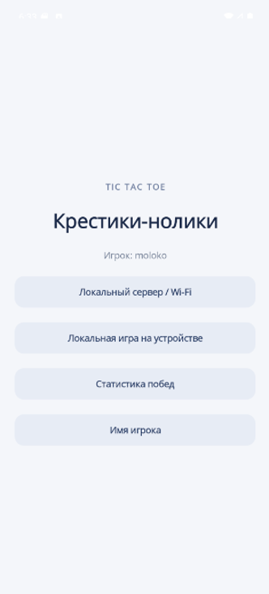
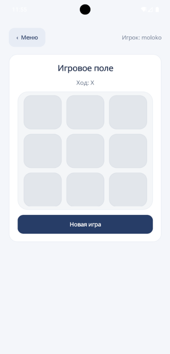
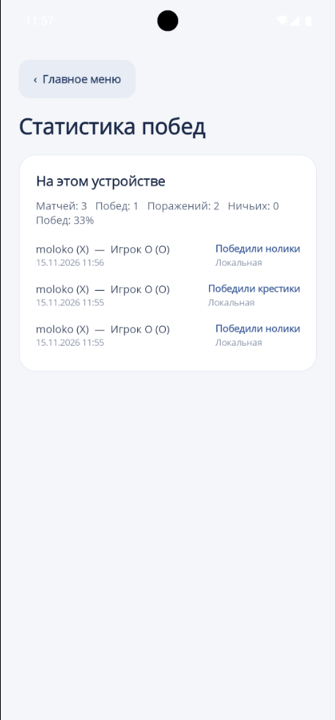
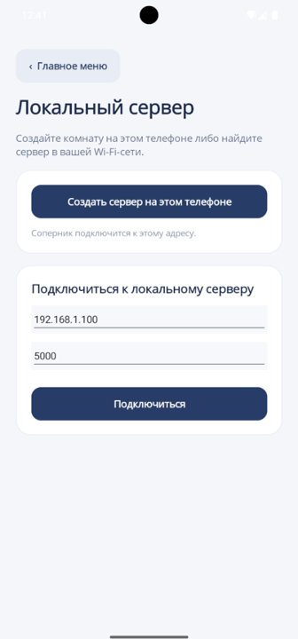

# TicTacToe

Кроссплатформенное приложение «Крестики-нолики», написанное на .NET MAUI и C#. Игра поддерживает матчи на одном устройстве, локальную игру по Wi-Fi в сети и сохранение результатов в SQLite.

## Возможности

- Локальная игра на одном устройстве для двух игроков.
- Онлайн-игра через локальную Wi-Fi сеть.
- Создание игровой комнаты на телефоне или другом устройстве.
- Подключение к комнате по IP-адресу и порту.
- Автообнаружение серверов в локальной сети.
- Отслеживание хода X/O, победителя и ничьей.
- Статистика матчей: победы, поражения и ничьи.
- История сыгранных партий с датой и именами участников.
- Сохранение данных локально с помощью Entity Framework Core и SQLite.

## Интерфейс

### Главное меню

На главном экране выбирается режим игры и задаётся имя игрока.



### Игровое поле

Игра происходит на поле 3 × 3. Интерфейс показывает имя игрока и чей сейчас ход.



### Статистика

Раздел статистики показывает общие результаты на устройстве и последние сыгранные партии.



### Локальный сервер

Для сетевой игры можно создать комнату на одном устройстве или подключиться к существующей комнате по адресу и порту.



## Режимы игры

### Игра на одном устройстве

Игроки поочередно ставят X и O на общем игровом поле. При заполнении поля или образовании линии победителя партия завершается.

### Игра по Wi-Fi

Одно устройство создаёт TCP-сервер и комнату. Второе устройство вводит IP-адрес сервера и порт из окна локального сервера, после чего подключается к матчу.

По умолчанию сервер использует порт `5000`. При блокировке фиксированного порта приложение может выбрать свободный порт автоматически.

## Структура проекта

| Проект | Назначение |
|---|---|
| `TicTacToe` | Основное .NET MAUI-приложение, страницы, ViewModel и сетевой клиент |
| `TicTacToe.Core` | Игровая логика, сетевой протокол и TCP-сервер |
| `TicTacToe.Data` | Entity Framework Core-модель и SQLite-база данных |
| `TicTacToe.Tests` | Тесты игровой логики, сетевого сервера и миграций |

## Технологии

- C# и .NET 10
- .NET MAUI
- CommunityToolkit.Mvvm
- Entity Framework Core
- SQLite
- TCP-сокеты
- xUnit

## Требования

- .NET SDK 10.
- Для сборки Windows-приложения: Windows 10 или новее с установленными компонентами MAUI и платформой Windows.
- Для Android-сборки: Android SDK и одно из поддерживаемых Android-устройств или эмуляторов.
- Для сетевой игры: устройства должны находиться в одной локальной сети и разрешать сетевое подключение на выбранный порт.

## Сборка и запуск

Клонировать или открыть репозиторий в Visual Studio / другой IDE с поддержкой .NET MAUI, затем выполнить восстановление пакетов и запустить приложение:

```powershell
dotnet restore .\TicTacToe.slnx
dotnet build .\TicTacToe.slnx
dotnet run --project .\TicTacToe\TicTacToe.csproj
```

Конкретный способ запуска зависит от выбранной MAUI-платформы.

## Тесты

Запустить тесты решения можно командой:

```powershell
dotnet test .\TicTacToe.slnx
```

## Хранение данных

Результаты и ходы сохраняются в локальной SQLite-базе приложения. База создаётся автоматически при первом запуске вместе с необходимыми таблицами и миграциями.
